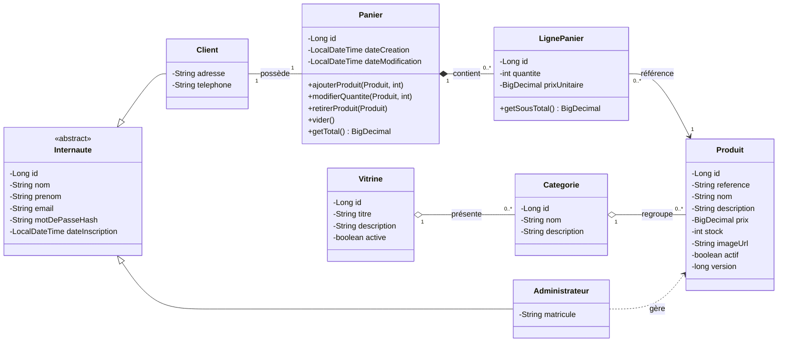
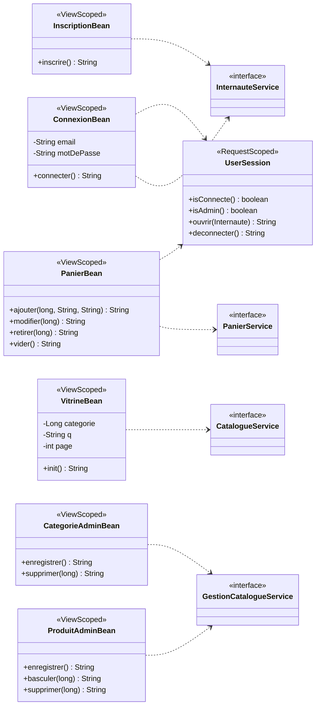

# Diagrammes de classes : atelier 3 (JSF et JPA)

## 1. Modèle métier (inchangé)

## 2. Couche JSF (nouvelle) : un bean par gestion (étape 4)

Correspondance avec l'atelier 2 :

| Atelier 2 (servlet) | Atelier 3 (bean) | Page Facelets |
|---|---|---|
| `ClientServlet` | `ConnexionBean`, `InscriptionBean` | `connexion.xhtml`, `inscription.xhtml` |
| `VitrineServlet` | `VitrineBean` | `vitrine.xhtml`, `detail.xhtml` |
| `PanierServlet` | `PanierBean` | `panier.xhtml` |
| `ProduitServlet` | `ProduitAdminBean` | `admin/produits.xhtml`, `admin/produit-form.xhtml` |
| `CategorieServlet` | `CategorieAdminBean` | `admin/categories.xhtml`, `admin/categorie-form.xhtml` |
